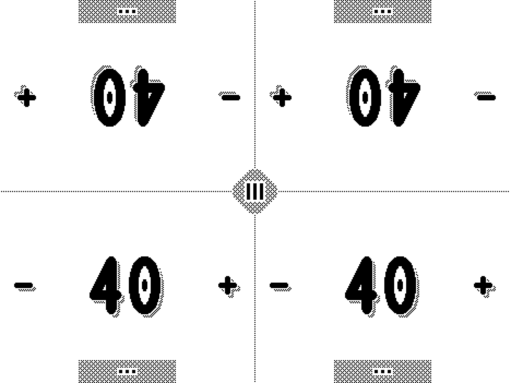

# Dither Tracker

A life tracker for Magic: The Gathering Commander, made for e-ink Android devices. The main target
is the Supernote Nomad (A6 X2). Everything on screen is pure black and white: no grey, no
anti-aliasing, and shading comes from dither patterns at an integer scale. The app has no
animations beyond short frame-by-frame hit effects, so the e-ink panel redraws as little as
possible.

It covers four players around one device: life totals, commander damage, commander tax, poison and
other counters, a game log with undo and redo, dice and a coin, and a first-player pick. Saves are
kept on the device and survive the app being killed.




The rules and design constraints are in [`docs/SPEC.md`](docs/SPEC.md). How the code is structured
is in [`docs/architecture.md`](docs/architecture.md). E-ink notes are in [`docs/eink.md`](docs/eink.md).

## Project layout

- `:core` is pure Kotlin/JVM: game state, rules, the save format. JUnit tests.
- `:app` is the Android app. It has one `Activity` and custom `View`s that draw on a `Canvas`.
  There are no AndroidX or Compose dependencies. `minSdk 26`, target/compile SDK 37.
- `design/` holds the source art as text files: icons, fonts, dither patterns and effects. The build
  turns them into Kotlin (`generateIcons`, `generateFonts`, `generateFx`). It also holds device and
  emulator captures.
- `tools/` holds the emulator script, the 1-bit purity checker and the capture harness.

## Requirements

- JDK 21, for example `export JAVA_HOME=/Library/Java/JavaVirtualMachines/jdk-21.jdk/Contents/Home`
- Android SDK with platform `android-37` and recent build-tools
- `local.properties` with `sdk.dir=/path/to/Android/sdk`. This file is gitignored.

Gradle comes from the checked-in wrapper, so you don't need a system `gradle`.

## Build and test

```sh
./gradlew :core:test :app:testDebugUnitTest   # unit tests
./gradlew :app:assembleDebug                  # app/build/outputs/apk/debug/app-debug.apk
./gradlew :app:assembleRelease                # app/build/outputs/apk/release/ (see below)
```

To install a debug build on a connected device or emulator:

```sh
adb install -r app/build/outputs/apk/debug/app-debug.apk
adb shell am start -n au.com.josephmark.dithertracker/.MainActivity
```

If more than one device is attached, add `-s <serial>` to every `adb` command. `adb devices` lists
the serials.

## Release build and signing

The release build runs R8 (code shrinking and optimisation) and resource shrinking. The release APK
is about 190 KB; the debug APK is about 1.4 MB. The app needs no keep rules of its own. The
adb-only QA hooks are compiled out of release builds: the `demo`, `partners`, `seed`, `fx`,
`cleanEvery` and `vendorRefresh` intent extras listed in `MainActivity`.

**No keystore, password or signing secret goes in this repo.** The build reads four values:
`storeFile`, `storePassword`, `keyAlias` and `keyPassword`. For each value it takes the first of
these that is set:

1. an environment variable: `DITHER_STORE_FILE`, `DITHER_STORE_PASSWORD`, `DITHER_KEY_ALIAS`,
   `DITHER_KEY_PASSWORD`
2. a Gradle property, for example in `~/.gradle/gradle.properties`: `dither.storeFile`,
   `dither.storePassword`, `dither.keyAlias`, `dither.keyPassword`
3. `local/keystore.properties`. The whole `local/` folder is gitignored. Keys there are
   `storeFile`, `storePassword`, `keyAlias` and `keyPassword`.

If `keyPassword` is not set, the build uses `storePassword`. A relative `storeFile` is resolved from
the repo root, but an absolute path outside the repo is safer.

What `assembleRelease` produces:

| Signing setup | Output |
|---|---|
| A keystore is configured | `app-release.apk`, signed and ready to install |
| No keystore (the default on a fresh clone) | `app-release-unsigned.apk`, plus a warning. Android won't install it until it is signed. |
| `-PdebugSignRelease` | `app-release.apk` signed with your local debug key, plus a warning. Use it for testing only. |
| `storeFile` set but the file is missing | The build fails with the path it looked for |

Why unsigned is the default rather than falling back to the debug key: Android only installs an
update over an existing app when both are signed with the same key. A release APK that was quietly
debug-signed would install fine, and the next properly signed release would then refuse to install
over it. The only way out is to uninstall, and uninstalling deletes the saved game. An unsigned APK
can't be installed by mistake, so the problem shows up at build time instead.

### One-time setup: create a release key

Do this once, on your own machine. Keep the keystore and its passwords outside the repo, and back
them both up. If you lose the key, you can't update an installed copy without uninstalling it first,
which deletes its save.

```sh
mkdir -p ~/keys
keytool -genkeypair -v \
  -keystore ~/keys/dither-tracker-release.jks \
  -storetype PKCS12 \
  -alias dither-tracker \
  -keyalg RSA -keysize 4096 \
  -validity 10000
```

`keytool` asks for a keystore password and for the certificate's name fields. The name fields can be
anything. Then point the build at the keystore. `local/keystore.properties` is the simplest way:

```properties
# local/keystore.properties: gitignored, never commit
storeFile=/Users/<you>/keys/dither-tracker-release.jks
storePassword=<the password you chose>
keyAlias=dither-tracker
```

Use the full path, because `~` is not expanded. You can use environment variables instead, so that
no password is ever written to a file:

```sh
export DITHER_STORE_FILE=$HOME/keys/dither-tracker-release.jks
export DITHER_KEY_ALIAS=dither-tracker
read -s DITHER_STORE_PASSWORD && export DITHER_STORE_PASSWORD
./gradlew :app:assembleRelease
```

To check the signature:

```sh
$ANDROID_HOME/build-tools/<version>/apksigner verify --print-certs app/build/outputs/apk/release/app-release.apk
```

### Versioning

`versionCode` and `versionName` are in `app/build.gradle.kts`. `versionName` is semver and shows in
the device's app list. Raise `versionCode` by one for every APK you hand to a device as an update.
Android refuses to install a lower `versionCode` over a higher one.

### Debug and release on the same device

Both builds use the same application id, `au.com.josephmark.dithertracker`, so only one can be
installed at a time. A debug build installs over a `-PdebugSignRelease` build and the reverse,
because both use the debug key, and the save is kept. Switching between a debug build and a build
signed with your release key needs `adb uninstall au.com.josephmark.dithertracker` first, which
deletes the save.

## Sideloading onto a Supernote Nomad

The Nomad runs Supernote's own system on Android 11 and has no Play Store. Apps go on by sideloading
an APK. These steps are based on Supernote's changelogs and on community guides. Steps marked
**(unverified)** have not been tried on a Nomad for this app.

### 1. Allow sideloading on the device

On the Nomad, open **Settings > Security & Privacy** and switch **Sideloading** on, then accept the
notice it shows. Supernote added this switch in firmware 3.18 (2024). Older firmware went through
Android developer options instead. Current firmware has removed that route, so update the firmware
if you can't find the switch.

### 2a. Install over USB with adb (recommended)

This is how the app has been installed during development.

1. On your computer, install Android platform-tools, which provides `adb`. For example, use
   `brew install android-platform-tools` on macOS or `winget install Google.PlatformTools` on Windows,
   or use the copy that comes with the Android SDK.
2. Connect the Nomad with a USB cable. Guides recommend a USB-A port where possible. Some
   computers, including Macs with only USB-C ports, have been reported to see the Nomad for file
   transfer but not in `adb`. If that happens, try another port, cable or hub.
3. Check that the Nomad shows up in the list:

   ```sh
   adb devices
   ```

4. Install the APK. `-r` replaces an installed copy and keeps its saved game:

   ```sh
   adb install -r app-release.apk
   ```

5. Start the app from the device, or from the computer:

   ```sh
   adb shell am start -n au.com.josephmark.dithertracker/.MainActivity
   ```

### 2b. Install by copying the APK to the device **(unverified)**

1. Connect the Nomad over USB in file-transfer (MTP) mode, or use Supernote Partner or Cloud, and
   copy `app-release.apk` to the device, for example into the `INBOX` or `Document` folder.
2. On the Nomad, open the APK from a file manager to start Android's package installer. The
   built-in file browser might not offer this. Community reports say it can show "Unsupported file
   format" for APKs, and that a third-party file manager such as MiXplorer works.

If this doesn't work on your firmware, use adb (2a).

### Where the app shows up

After install, Dither Tracker appears with its heart icon and "Dither Tracker" label in the Nomad's
**Settings > Apps > My Apps** list. That list has been checked on a Nomad.


Opening it from the home screen or sidebar app launcher is **(unverified)**, as the exact place
depends on the firmware. The app runs full screen in landscape.

### Updating

Build a new APK with a higher `versionCode`, signed with the **same key**, and run
`adb install -r app-release.apk` again, or open the new APK as in 2b. The saved game is kept. If the
install fails with `INSTALL_FAILED_UPDATE_INCOMPATIBLE`, the APK is signed with a different key than
the installed copy. Uninstall the old copy first; this deletes the save.

### Uninstalling

From the computer:

```sh
adb uninstall au.com.josephmark.dithertracker
```

Or on the device: **Settings > Apps > My Apps**, pick Dither Tracker and uninstall it **(the
on-device route is unverified)**. Uninstalling deletes the saved game and settings.

### A note on the e-ink panel

Supernote doesn't promise a good experience with third-party apps on its panel. Dither Tracker is
built around this. It only uses black and white and keeps each change's pixel footprint small, and
a "Screen clean" setting clears ghosting after a number of taps. See [`docs/eink.md`](docs/eink.md).
