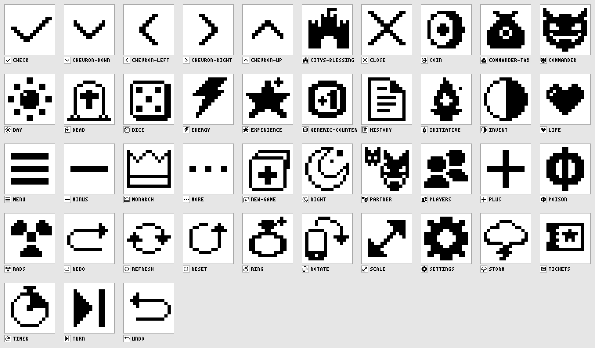

# Icons

16×16 1-bit icons, hand-authored as ASCII. The source of truth for every icon in the app.



Inverted (dark mode / pressed state): [`contact-sheet-inverted.png`](contact-sheet-inverted.png).

## Format

- One file per icon: `design/icons/<kebab-name>.txt`.
- Exactly 16 lines of exactly 16 characters, ending with a single trailing newline.
- `#` = black (ink), `.` = white. No other characters.
- The outer 1px ring is always empty, so the art lives in the inner 14×14.

## Style

Direction (see `docs/SPEC.md`, "Tone"): friendly and lighthearted, slightly cutesy, never clip-art or
emoji knock-offs. The T24 redesign moved the set from thin 1px outlines to chunky shapes. Compare
[`contact-sheet-before.png`](contact-sheet-before.png) /
[`contact-sheet-inverted-before.png`](contact-sheet-inverted-before.png) with the current sheets.
The candidate sketches the picks came from are in [`candidates/`](candidates/), as PNGs only, so the
build never sees them.

- **Weight: solid forms with white knockouts, or 2px strokes.** Counters and badges (`poison`,
  `life`, `energy`, `experience`, `rads`, `commander`, `commander-tax`, `monarch`, `citys-blessing`,
  `players`, `partner`, `settings`) are solid silhouettes. The detail is cut out in white: eye sockets,
  a glint, a coin, a gate. Simple UI glyphs (`plus`, `minus`, `menu`, `more`, `close`, `check`,
  `chevron-*`) keep their plain 2px strokes.
- **1px lines need a solid anchor.** A 1px outline is fine for a long curve or a big outline (a ring,
  cloud, page, die face, card or tombstone) as long as something solid carries the weight: a filled
  arrowhead, a bolt, pips, a cross, the wedge on `timer`, the edge on `coin`, the thickness on `dice`.
- **Arrows have solid triangular heads** (the `refresh`/`reset` language). `undo`, `redo`, `rotate`,
  `scale` and `turn` all use it.
- **Character in small doses.** A detail goes in only where the object already has one: an imp's
  face, a helmet's plume, a sparkle on `experience`, `ring` and `night`, a glint on `life` and `day`,
  grass at the foot of `dead`, a flag on `citys-blessing`. Utility glyphs get no character.
  Never give a face to an object that doesn't have one.
- **Optical size.** Round and solid shapes sit at about 12×11 to 12×13. Thin open shapes such as
  the sun, rotate and storm may fill the whole 14×14. Utility glyphs keep their own sizes.
  `validate.py --report` prints bbox, ink count and density (ink ÷ bbox). Solid icons land at about
  0.45–0.7, outline icons at 0.25–0.45.
- **Curves are stepped diagonals** (1-1, 2-1, 1-2 runs), never jaggy noise.
- **Optically centred.** The ink bounding box is centred on (7.5, 7.5), to within half a pixel.
- **Must read inverted.** Check every icon on the inverted sheet, because pressed feedback and
  dark mode both swap black and white. Knockout details must survive the swap: a white glint
  becomes a black one.
- **Original drawings only.** No traced MTG set symbols or mana glyphs, and no copies of the official
  energy or Phyrexian/poison symbols. `energy` is a generic bolt. `rads` is a generic hazard trefoil.

## Tools (Python 3 stdlib only)

```sh
python3 design/icons/validate.py            # format, margin, duplicate checks (exit 1 on failure)
python3 design/icons/validate.py --report   # also print bbox, centre offset, ink count, density
python3 design/icons/render.py              # writes contact-sheet.png + contact-sheet-inverted.png
python3 design/icons/render.py --scale 4 --cols 8
python3 design/icons/render.py --src /tmp/sketches --out /tmp --name candidates   # render a folder of sketches
```

On the contact sheet, each icon is drawn at 8× nearest-neighbour inside a grey frame that marks the 16×16 bounds. A 1× preview and the name sit underneath. The grey frame and labels are only there for review: the icon pixels themselves are pure black and white.

## Icon list

| Icon | Depicts | Used for |
|------|---------|----------|
| `poison` | Phyrexian symbol: a heavy ring with a vertical beam through it, the beam separated from the ring by a 1 px white gap (option E in `candidates/poison-options.png`, Sam's pick; a Wizards of the Coast mark — revisit if the app is distributed) | Poison counter (drawer, peeks) |
| `storm` | Lumpy cloud with a heavier base and a solid bolt beneath | Storm counter (drawer) |
| `rads` | Compact solid trefoil with a square centre | Rad counter (drawer) |
| `energy` | Chunky solid lightning bolt | Energy counter (drawer) |
| `experience` | Solid five-point star with a sparkle | Experience counter (drawer) |
| `commander` | Cheeky imp head: little horns, slanted eyes and a fanged grin knocked out, pointed chin | Commander damage (main play button, damage view) |
| `commander-tax` | Money sack, tied at the top, with a coin knocked out | Commander tax counter, one per commander |
| `tickets` | Ticket: solid stub, dashed perforation, star on the face | Tickets counter (drawer) |
| `generic-counter` | Round token marked "+1" | Generic/custom counter (drawer) |
| `life` | Plump solid heart with a glint | Life total, starting-life setting |
| `monarch` | Solid crown with three ball-tipped points and a jewelled band | Monarch toggle (panel badge) |
| `initiative` | Torch: solid flame with a white inner flame, cup and handle, one spark | Initiative toggle (dungeon), panel badge |
| `citys-blessing` | Solid castle: flagged keep between two towers, with an arched gate | City's blessing toggle (panel badge) |
| `ring` | 2px ring with a solid gem and a sparkle | Ring-bearer toggle (panel badge) |
| `day` | Solid sun with a glint and eight block rays | Day state (global day/night) |
| `night` | Solid crescent moon with a twinkle | Night state (global day/night) |
| `dead` | Tombstone outline with a solid cross, on grassy ground | Auto-KO marker and toggle |
| `dice` | Die face showing five, with 3D depth on the right and bottom | Dice tool (d6/d20/custom) |
| `coin` | Coin at an angle: face with an embossed dot, solid edge | Coin-flip tool |
| `timer` | Stopwatch with a solid elapsed-time wedge | Turn/game timer |
| `turn` | Solid play triangle with an end bar (next/skip) | Turn tracker, pass turn |
| `undo` | Hooked arrow, solid head pointing left | Undo (menu) |
| `redo` | Hooked arrow, solid head pointing right | Redo (menu) |
| `reset` | Single anticlockwise circular arrow, solid head | Reset life/counters (with confirm) |
| `new-game` | Fresh card with a plus, a second card behind | New game |
| `settings` | Solid gear with a round hole | Settings entry |
| `history` | Page with a solid folded corner and text lines | Game history log |
| `players` | Two solid people, one in front of the other | Player count & layout setting |
| `menu` | Three bars | Centre diamond menu button |
| `more` | Three dots | Drawer tab, overflow |
| `plus` | Plus | Increment (+) |
| `minus` | Minus | Decrement (−) |
| `close` | X | Close drawer, overlay or dialog |
| `check` | Tick | Confirm, enabled toggle |
| `chevron-left` | Left chevron | Back, previous page, stepper |
| `chevron-right` | Right chevron | Forward, next page, stepper |
| `chevron-up` | Up chevron | Collapse, page up |
| `chevron-down` | Down chevron | Expand, page down |
| `invert` | Half-filled circle | Invert (dark mode) setting |
| `scale` | Diagonal double-headed arrow, solid heads | Integer scale S setting |
| `rotate` | Phone (with a chin and home button) and a curved arrow | Seat/screen orientation |
| `partner` | The `commander` imp (smaller) with a tiny fanged sidekick imp at its shoulder | Partner commanders (two damage sources) |
| `refresh` | Two clockwise circular arrows, solid heads | Full e-ink refresh (ghosting cleanup) |

## Telling similar icons apart

- `undo` and `redo` are open hooks, while `reset` and `refresh` are closed circles. `reset` has one anticlockwise arrow and `refresh` has two clockwise arrows. `rotate` is the only one with a device in it.
- `day` has block rays that stand apart from a solid disc. `settings` has teeth joined to the body and a big hole in the middle.
- `monarch` (crown) and `commander` (imp) share no outline: the imp's horns are single curved points, the crown has a straight band. `partner` reuses the `commander` imp face on purpose, so the two read as related, and adds a tiny sidekick so it never reads as a single imp. `players` uses the same front/back overlap with people.
- `coin` is a single angled coin with a solid edge. `commander-tax` is a money sack. `generic-counter` is a flat round token marked "+1". `invert` is a perfect circle split down the middle with no emblem.
- `storm` is a cloud with a small bolt. `energy` is a big bolt on its own.
- `dead` (tombstone) is the only arched slab, and its grassy ground extends past the stone. `commander` and `partner` (imps) are the only faces.
- `new-game` (card with a plus) has a second card behind it. `dice` has pips and a thick edge.
- `experience` (star), `ring` and `night` all carry a small sparkle. The sparkle is decoration, not the thing the icon means.
