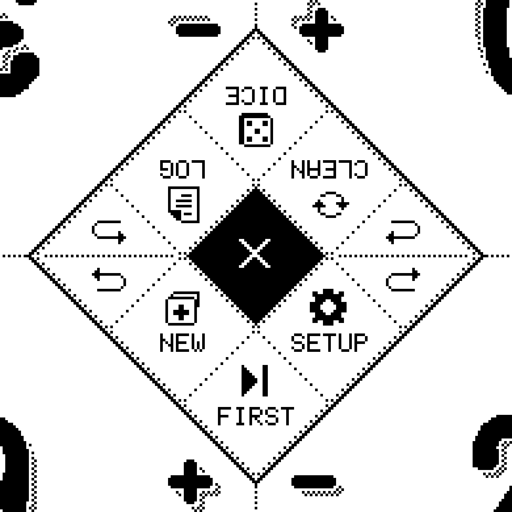
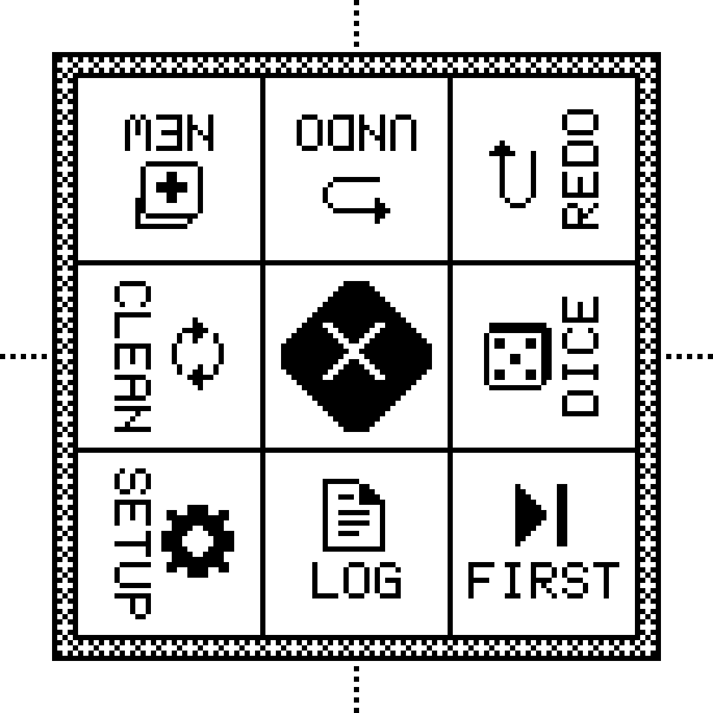
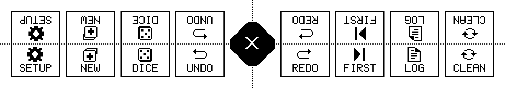
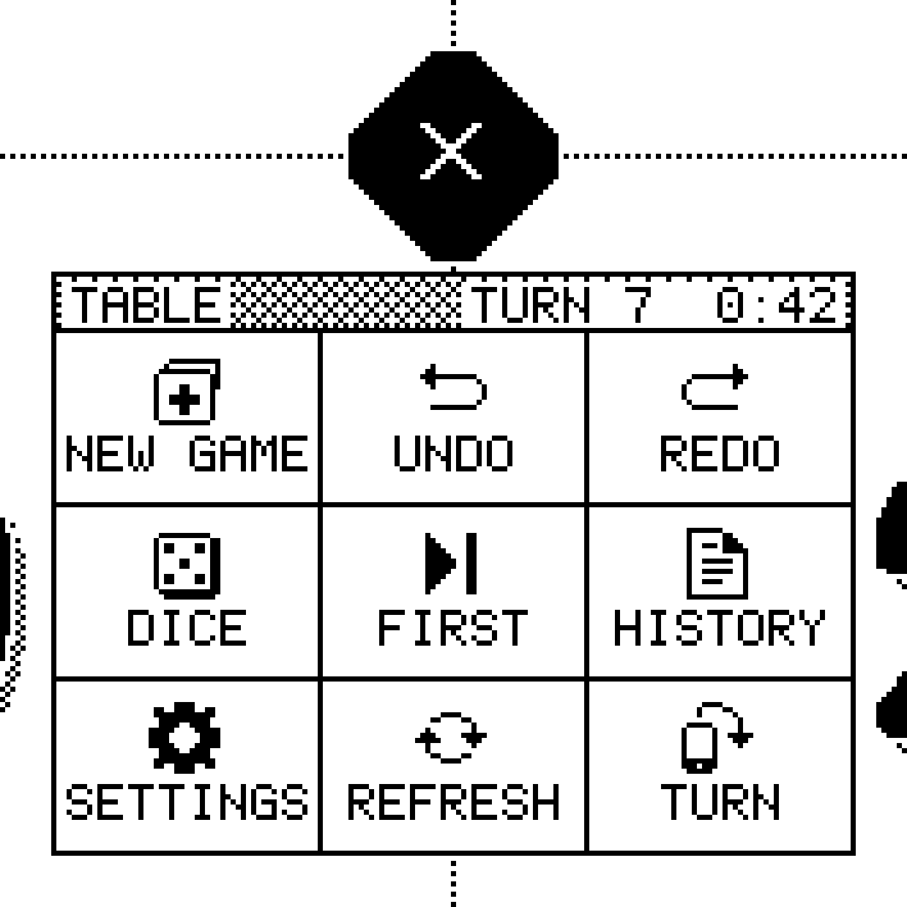

# T36 — Centre menu concepts

Sam liked that the Lotus radial menu (`design/reference/lotus-menu.webp`) isn't aimed at any one
player, but not its angled pills. These are four ways to get the same result in our language:
everything axis-aligned on the dither grid, turned only in 90° steps, built from real icons
(`design/icons/`), real faces (`ui`, `num-m`, sticker `num-l`) and real fills (`D6` = `Role.MENU`,
`CHECKER` shadows) at global phase.

All mocks are true device pixels (1872×1404, S = 4), pure 1-bit, and pass
`tools/check_1bit.py --scale 4`. Regenerate them with `python3 design/menu/render.py` (stdlib only).
The renderer mirrors `PlayLayout` (T27 sticker numerals, ± glyphs, 89×21 tabs, commander button,
R24/cut-4 diamond) and prints, for each mock, the **flips** (dither px that differ from the
closed screen; ×16 for device px), the changed **bounding box**, and how many px of **life-total
ink** it covers.

| File | What |
|---|---|
| `closed.png` | Play screen, menu closed (reference for every concept) |
| `concept-<n>-<name>-open.png` | Full screen, menu open |
| `concept-<n>-<name>-detail.png` | The changed region at 2× device px (8 px per dither px) |
| `concept-1-gem-key1.png` | Optional bloom keyframe (closed → key1 → open) |
| `concept-1-gem-allsides.png` | Gem with a seat on every edge (orientation rule, see below) |
| `concept-1-gem-pressed.png` | NEW facet pressed (inverted) |
| `concept-1-gem-confirm.png`, `-dice.png`, `-settings.png`, `-settings-north.png` | Second level |
| `concept-4-turntable-north.png`, `-east.png` | Turntable card swung to other seats |

## Where the menu can live

The free space on the 2×2 play screen is a fat **plus** around the crossing: a horizontal band
y 116–234 (119 px tall, edge to edge) between the top and bottom rows of numerals, and a vertical
channel between the inner ± glyphs (only 27 px wide at y 78–97 and 253–272). The intersection of
the two is roughly a *diamond*: anything inside |dx| + |dy| ≤ ~100 of the crossing hides no life
total and no ± glyph. That's why the gem fits so well.

## First level (same eight in every concept)

| Icon | Short / long label | Action |
|---|---|---|
| `new-game` | NEW / NEW GAME | restart → confirm |
| `undo` | UNDO | undo the last change; the menu stays open |
| `redo` | REDO | redo; the menu stays open |
| `dice` | DICE | roll (d20 by default, last die remembered) → result; d6 and coin are on the result |
| `turn` | FIRST | random starting player (Lotus's "High roll") → marks the chosen seat |
| `history` | LOG / HISTORY | history log + turn/timer (T17/T18) → panel |
| `settings` | SETUP / SETTINGS | settings → panel (player count lives here) |
| `refresh` | CLEAN / REFRESH | full e-ink refresh (ghost cleanup), then closes |

Second level holds the rest: dice type and coin, settings pages, history. **Player names and
patterns** belong in each player's own drawer (they're personal), not in the table menu. Labels are
at most 5 characters where space is tight, 8 where there's room. The centre is always **close**: the
diamond inverts to solid ink with the `close` glyph knocked out of it, so "open" is unmistakable.

---

## 1 · Gem *(recommended)*

**Idea.** The diamond blooms into a big stepped diamond cut into a 3×3 lattice of diamond facets.
The centre facet is the inverted diamond (close) and the eight facets around it are the tools. Every
edge is a 45° staircase, which is pixel-perfect on our grid. The gutters between facets are `D6`
(MENU), which reads as dotted diagonals that continue the dotted-divider language. There's a 3-px
MENU rim inside a 1-px staircase outline, like a gem in its setting. Text and icons inside the
facets stay axis-aligned.

**Orientation rule: each facet faces the nearest edge that has a seat.** At the 2×2 table (seats
on the two long edges only), the upper three facets face N and the lower three face S. The two
**tip facets on the horizontal divider are two-faced**: an icon-only `undo` (W tip) and `redo`
(E tip) drawn upright below the fold and turned 180° above it, with the dotted divider itself as the
fold. Items sit in point-symmetric pairs: undo|redo, dice|first, log|setup, clean|new. Each long
side therefore reads one of every pair upright and the same kinds of tool on its own half, and
neither side owns the menu. With a seat on a short edge (3/5/6-player layouts), the facets nearest
that edge turn to face it (`-allsides.png` shows all four edges occupied: tips face out, diagonals
pinwheel).

- Footprint: diamond R 87 (bbox 175×175 dither px, ~59 mm), centred on the crossing.
  **Hides 0 px of life ink**, no ± glyph, tab or commander button.
- Targets: 8 facets, each a diamond 53 px across. The narrowest width (edge to edge) is ~39 px,
  about 13 mm, so all are above the 27-px / 9-mm minimum. Hit-testing is |dx| + |dy| in the lattice.
- Flips to open: **~3,000 dither px** (48k device px), all inside the diamond. The optional bloom
  is closed → key1 (1,428) → open (2,291). key1 is the empty doubled diamond with the close
  already showing.
- Pressed: the facet inverts (`-pressed.png`, ~1,400 flips).

**Strengths.** It's the diamond grown up: instantly "the same button, open", and on-brand. It fits
the free space exactly and covers no life total. It's compact and point-symmetric, and the 45°
staircases make it a little playful while the axis-aligned contents keep it sleek. Undo/redo are
legible from both sides and never mistaken for each other.
**Weaknesses.** Facets are small for text: 5-char labels in the 1× `ui` face, and undo/redo have
no label. Labels on the far half are upside-down for you (icons carry them). Hit-testing diamonds
is unusual (simple maths, but new code).

### Second level

The second level uses **tent panels** for short messages, so they're never aimed at one seat, and a
**turning card** for long tasks.

- **Restart confirm** (`-confirm.png`): a two-faced panel on the crossing. The prompt from
  `design/copy/quips.md` ("New game? / Shuffle up, we go again") faces S below the fold and N above
  it. The fold row holds the two-faced buttons *Keep going* and *Start over* (inverted = the action),
  with the close diamond still at the crossing (= keep going). It's 199×101, inside the free band,
  hides no life, and takes ~7,000 flips from the open gem.
- **Dice result** (`-dice.png`): the same tent with the sticker hero numerals ("17"), the die
  ("d20") and a quip ("No take-backs") on each face. The fold row has two-faced *D6* and *Coin*
  buttons. The fold diamond shows the `dice` glyph knocked out: tap it to roll again, tap outside to
  go back. It's 161×149, kept clear of the ± glyphs, and hides no life. The result is a single
  redraw (rule 4 allows a 2–3-key reveal later). The coin uses the same panel.
- **Starting player** (not mocked): no panel. The chosen seat gets the "Goes first" caption under
  its name, facing that player, and the menu closes. The result belongs to that seat.
- **Settings** (`-settings.png`, `-settings-north.png`): a **square** 227×227 card centred on the
  crossing, so it has the same footprint whichever way it turns. It opens facing the edge of the
  facet that was tapped (SETUP faces S), and the header's `rotate` button turns it to the next
  occupied edge (180° at the 2×2 table, 90° steps when side seats exist). Close is the inverted
  square at the header's other end. Rows are 27 px and the whole row is the hit target. It has
  steppers (`minus`/`plus` + `num-m`), ON/OFF toggles, dotted row rules, and pages with chevrons
  (no scrolling). It covers life totals while open, which is acceptable for a mode you visit between
  games. History and Players-count use the same card.

---

## 2 · Pinwheel block

**Idea.** A 3×3 block of 35-px square tiles on one shared 1-px grid, centred on the crossing, in a
3-px MENU rim. The centre cell holds the inverted diamond (close).
**Orientation rule: pinwheel.** Moving clockwise, each pair of tiles faces one edge: the top-left
and top tiles face N, top-right and right face E, bottom-right and bottom face S, bottom-left and
left face W. Every edge reads exactly two labels upright.

- Footprint 117×117 dither px (40 mm square). Hides 0 px of life ink.
- Targets 35×35 (12 mm). Flips to open ~3,500.
- **Strengths:** the most compact and the plainest to build (rect hit-tests). The four-edge
  fairness is literal.
- **Weaknesses:** at the 2×2 table nobody sits at E or W, so four labels are sideways for
  everyone. Undo and redo end up turned differently (undo faces N, redo E), so the arrows don't
  read as a pair. It feels more like a utility grid than ours. It's less playful than the gem.

## 3 · Tent ribbon

**Idea.** The horizontal divider threads a row of **tent cards**. Each button carries its icon and
label on both faces: upright below the dotted fold for the near side, and 180° above it for the far
side. The close diamond sits at the crossing, and undo/redo sit right beside it where both sides
reach.

- Footprint 441×61 (the full width of the table, y 145–205, inside the free band). Hides 0 px of
  life ink. Flips ~4,400.
- Targets 45×61 (15×20 mm).
- **Strengths:** every label is upright for every player at the 2×2 table, with no reading upside
  down. It's very calm and legible, and the divider-as-fold idea is lovely and clearly ours.
- **Weaknesses:** it's wide. It splits the whole table, and the outer buttons are a long reach from
  the far seats. It doubles the ink. It does nothing for short-edge seats, and other layouts would
  need a vertical ribbon. Lotus's charm of "a thing at the centre" is diluted.

## 4 · Turntable

**Idea.** The conventional answer, done in our language. A single card with full-word labels (NEW
GAME, SETTINGS, REFRESH, …) and a header carrying the table's turn/timer readout ("TURN 7  0:42")
hangs off the diamond toward the seat that opened it (the half of the diamond you tapped). Its ninth
tile, TURN (`rotate`), swings it to the next seat in one redraw (`-north.png`, `-east.png`).

- Footprint 157×157. When facing S or N it hides 0 px of life ink (only the inner ± glyphs). When
  swung E or W it covers ~900 px of the side players' totals. Flips ~3,900–4,500.
- Targets 51×33 (17×11 mm).
- **Strengths:** the most readable labels, the most familiar pattern, and a natural home for the
  turn/timer.
- **Weaknesses:** it **points at one player at a time**, which is exactly what Sam liked Lotus for
  avoiding. Others have to swing it or read upside-down. It overlaps players' ± zones, so a stray
  tap could land on the card.

## Rejected along the way

- **Compass**: two tiles per divider arm, with labels facing outward. Rendered in pass 1. It looked
  like a clunky D-pad, its E/W arms were sideways for everyone at a 2×2 table, and the inner ±
  glyphs leave only a 27-px channel for the vertical arms. The pinwheel does the same job more
  compactly, so the compass was replaced by the turntable.
- **Four mini-menus** (one per seat corner): this quadruples the ink and flips and crowds every
  tile. Not drawn.
- **Gem with a pinwheel at the 2×2 table**: in pass 1 the undo facet turned upside down looked like
  redo to the near side, with both arrows pointing right. This led to the two-faced tip facets.

## Recommendation: the gem, with tent panels for the second level

1. **It keeps the quality Sam likes.** The gem is centred, symmetric and belongs to the table.
   Instead of Lotus's arbitrary angles it uses the one diagonal that's pixel-perfect for us (the 45°
   staircase), while all text stays axis-aligned.
2. **It's the cheapest on e-ink.** At ~3k dither px it's the smallest flip count of the four, all
   inside one diamond. It covers no life total, ± glyph or tab, and the optional bloom is one extra
   keyframe of 1.4k px.
3. **It reads well at the actual table.** The occupied-edge rule means each long side reads half the
   facets upright and gets a matching kind of tool. The two-faced undo/redo tips can't be misread,
   and the rule generalises to side seats.
4. **The pieces form one system.** The gem handles navigation, two-faced tent panels on the same
   crossing handle messages (confirm, dice, coin), and a square turning card handles long tasks
   (settings, history). The centre is always the way back.

## Open questions for Sam

1. **Labels upside-down on the far half.** Is that fine, given the icons carry the meaning, or should
   the gem go icon-only with the label shown on the pressed facet? Or should every facet be
   two-faced like the tips, with icons only?
2. **Bloom keyframe.** Do you want the closed → key1 → open beat, or a single redraw? It costs
   ~1.4k extra flips and ≥250 ms.
3. **Undo/redo with no label.** Is the tent-facet treatment with icons only OK? Should undo also be
   reachable without opening the menu (for example a long-press on the diamond)?
4. **FIRST closes the menu** and marks the seat. Is that right, or should it show a tent result like
   dice does?
5. **CLEAN on the first level.** Is a manual refresh worth a facet, or should it live in settings
   with the auto-refresh cadence and a long-press on the diamond?
6. **Settings card.** Should it open facing the tapper's side? We can't know where the tap came
   from, so it faces the edge the SETUP facet faces. Alternatively it could remember the last
   facing.
7. **Confirm copy.** Should the confirm's quip line follow the quips setting, falling back to
   "Reset game? / Yes / No" when quips are off?
8. **Gem rim.** Keep the 3-px MENU rim (it echoes the old diamond fill), or go outline-only for an
   even sleeker look (~400 fewer flips)?
